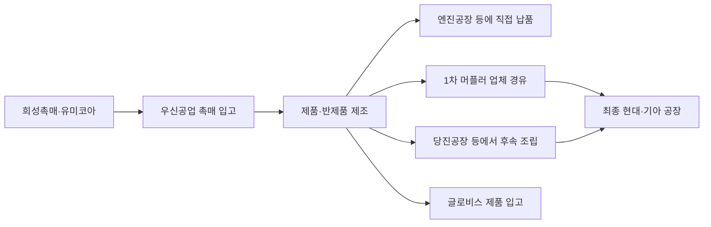
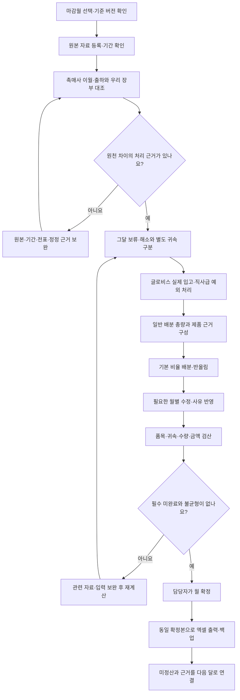

> 이 문서는 다른 프로젝트인 `촉매마감_rev1`에서 진행 중인 촉매 마감 프로그램의 업무 프로세스와 개발 상태를 설명하는 참고 자료입니다.
> 이 저장소에는 설명 문서만 공유하며, 해당 프로젝트의 코드와 원본 업무자료는 포함하지 않습니다.
> 본문에 적힌 구현 상태는 문서 작성일(2026-10-13) 기준이며, 하단의 상대 경로 링크는 원본 프로젝트 내부 문서를 가리킵니다.

# 처음 보는 사람을 위한 촉매 마감 업무 프로세스

작성 기준: 2026-10-13. 대상: 신규 마감 담당자, 업무 인수인계자, 프로그램 개발자.

**촉매 마감은 이번 달에 정산할 촉매의 수량·금액과 마감처를 확정하고, 정산하지 못한 수량을 다음 달로 넘기는 업무입니다.** 우리 회사에 촉매가 들어온 수량, 제품을 만든 수량, 실제 정산하는 수량은 서로 다를 수 있습니다.

이 문서는 현재 합의된 업무를 설명합니다. 프로그램은 현재 월 작업·메모 저장까지만 구현되어 있습니다. 아래 자료 읽기·배분·검산·확정·엑셀 출력은 앞으로 구현할 업무 흐름입니다. 실제 ERP나 현대기아 시스템에 자동 등록하는 기능은 현재 범위에 없습니다.

## 1. 먼저 실물이 어떻게 움직이는지 이해합니다

촉매사인 희성촉매·유미코아에서 촉매를 받아 컨버터 제품을 만듭니다. 제품이 바로 공장으로 가거나, 다른 업체·우리 당진공장을 거쳐 머플러로 조립된 뒤 최종 공장으로 갑니다.

위 그림은 대표 경로입니다. 품번별 승인 경로와 예외를 사용하며, 모든 제품을 같은 경로로 처리하지 않습니다.

**물건이 도착한 곳과 촉매를 마감하는 곳은 다릅니다.** 예를 들어 세종공업(화성)으로 납품된 제품의 확인 경로는 최종 울산3공장으로 연결되므로 촉매도 해당 세부 공장으로 배분합니다. 우리 ERP에서는 울산1·3·5 등의 상세를 합쳐 ‘현대 울산’으로 관리합니다.

| 용어 | 이 업무에서의 의미 |
|---|---|
| 촉매 입고 | 촉매사에서 우리 회사로 들어온 촉매. ERP 촉매 입고 자료로 대조합니다. |
| 제품 이동·납품 | 제품이나 반제품이 창고·협력사·공장으로 이동한 기록. 일반 배분의 비율 근거입니다. |
| 마감 | 이번 달 정산 대상으로 확정한 촉매 수량과 금액입니다. |
| 미정산·마감이월 | 이번 달 정산하지 못해 남긴 촉매 수량입니다. 품번·귀속·단가·근거를 함께 보관합니다. |
| 제품 이월 | 전월에 남은 제품 물량입니다. 촉매의 미정산과 다른 수량입니다. |
| 사급 | 고객 측에서 제공한 자재를 사용해 제품을 만드는 방식입니다. 이 업무의 글로비스 사급 촉매는 제품을 만들었어도 실제 제품 입고 조건을 충족해야 마감할 수 있습니다. |
| BOM | 제품·반제품 하나에 어떤 촉매가 몇 개 들어가는지 연결하는 구성표입니다. |
| 마감처 | 촉매를 정산할 귀속처입니다. 직접 납품처·경유처·세부 공장·ERP 통합처를 구분합니다. |

## 2. 마감 결과가 답해야 하는 세 가지 질문

1. 이번 달 실제로 마감하는 촉매는 몇 개이며 금액은 얼마인가요?
2. 그 수량을 어느 세부 공장과 ERP 마감처에 귀속하나요?
3. 마감하지 못한 수량은 몇 개이며 어떤 근거로 다음 달에 넘기나요?

보고서는 이 세 결과와 계산 근거가 서로 연결되어야 합니다. 수량 합계만 맞고 품목·귀속이 틀린 결과는 완료가 아닙니다.

## 3. 어떤 자료를 준비하나요?

| 자료 | 해결하는 질문 | 주기·관리 |
|---|---|---|
| 촉매사 전월 말 적송재고 PDF | 전월 말 촉매사 기준으로 얼마나 남았나요? | 매월 수령. 본문 재고 기준월을 확인합니다. |
| 희성 당월 출하 원본 | 희성이 이번 달 우리 회사로 얼마나 보냈나요? | 매월 수령. 가공 마감표는 비교용 또는 생성 결과입니다. |
| 유미코아 Summary·주차 납품 자료 | 납품·이월·공장 구분과 원문 마감은 어떻게 표시됐나요? | 매월 수령. Summary와 주차를 함께 합산하지 않습니다. |
| ERP 기간별구매거래처입고현황 | 우리 전산의 당월 촉매 입고는 얼마인가요? | 매월 조회. 촉매사 출하와 비교하며 둘을 더하지 않습니다. |
| 제품·반제품 창고별 수불집계조회 | 어느 경로로 제품이 얼마나 이동했나요? | 필요한 월에 각각 조회. 승인된 집계 지점·항목만 사용합니다. |
| 글로비스 실제 제품 입고 자료 | 글로비스에서 실제 입고처리한 제품은 무엇인가요? | 해당 거래가 있는 달에 조회. 현재 지정 원본은 `HkmgMmin020` 계열 파일입니다. |
| BOM·경로·단가 | 어떤 촉매·소요량·마감처·단가를 적용하나요? | 승인된 기준 재사용. 변경 때 새 버전으로 적용합니다. |
| 전월 확정 명세·미정산 | 우리 전월 장부와 이번 달 해소 대상은 무엇인가요? | 전월 확정본 연결. PDF 이월에 다시 더하지 않습니다. |
| 소요량·월계획 | 계획과 비교하면 어떠한가요? | 월·계획 버전별 등록. 계획 미제공과 0계획을 구분합니다. |

파일명 날짜는 추출일일 수 있습니다. 조회 범위·본문 기준월·수정본을 확인합니다. 파일에서 행이 없다는 사실만으로 거래가 0개라고 판단하지 않습니다.

## 4. 한 달의 업무 순서

| 단계 | 수행할 일 | 완료 결과 |
|---|---|---|
| ① 시작 | 마감월, 전월 확정본, 적용 BOM·경로·단가를 선택합니다. | 이번 달 계산에 사용할 기준이 고정됩니다. |
| ② 원본 등록 | 자료별 역할·기간·개정을 확인하고 원본을 보관합니다. | 같은 파일·겹치는 수정본을 중복 합산하지 않습니다. |
| ③ 원천 대조 | 촉매사 이월+납품과 우리 이월+ERP 입고를 각각 비교합니다. | 적용 수량과 차이 처리 근거가 연결됩니다. |
| ④ 정산 조건 | 전월 보류의 계속·해소, 당월 새 보류와 별도 귀속을 판단합니다. | 마감 가능한 부분과 남겨야 할 부분이 구분됩니다. |
| ⑤ 글로비스·예외 | 실제 제품 입고에 BOM을 적용하고 촉매별 직사급 예외를 분리합니다. | 고정 귀속분과 미입고 잔여가 연결됩니다. |
| ⑥ 일반 배분 | 관련 제품의 승인된 수불 수량×BOM 기여를 합산해 촉매 대상군별 비율을 구합니다. | 자동 배분 후보와 분자·분모가 남습니다. |
| ⑦ 검토·수정 | 필요한 제품 분할·촉매 최종 수량·보류 처리만 입력합니다. | 자동값과 수정값·사유를 별도로 유지합니다. |
| ⑧ 검산·확정 | 품목별 잔액과 명세·공장·ERP·금액 합계를 확인한 뒤 확정합니다. | 확정 당시 자료·기준·명세·미정산이 함께 저장됩니다. |
| ⑨ 출력·이월 | 확정본에서 제출·검토 엑셀을 생성하고 다음 달 잔여를 연결합니다. | 출력마다 같은 수량·금액을 사용합니다. |

원본 차이가 남아 있어도 다른 품목 검토와 초안 저장은 할 수 있습니다. 해결되지 않은 필수 항목을 숨긴 채 월 전체를 확정하지 않습니다.

## 5. 수량은 어떻게 계산하나요?

### 5.1 희성의 시작 수량

`희성 적용 전월 말 촉매 이월 + 당월 촉매 출하 = 적용 가용량`

전월 말 PDF에서 이월 기본값을 가져오고 자체 전월 확정 이월과 대조합니다. 인식 정정·업무 조정이 있으면 원본과 다른 항목으로 기록합니다. 수정은 원본에 더하는 수량이 아니라 적용할 이월 수량을 대체하는 값입니다.

유미코아는 기존 공장별 명세와 실제 미마감 판단을 연결합니다. 이미 구분된 명세 전체를 희성 방식으로 다시 배분하지 않으며, 다중 귀속이 필요한 범위만 승인된 공통 비율을 사용합니다.

### 5.2 실제 마감과 미정산을 먼저 구분

`적용 가용량 = 별도로 귀속한 실제 마감 + 일반 마감 + 월말 미정산`

일반 배분 대상은 적용 가용량에서 그달 남길 보류와 글로비스·직사급 등의 별도 확정 귀속분을 분리한 수량입니다. 보류 항목은 서로 중복되지 않게 관리합니다. 전월 보류가 해소되더라도 이미 가용량에 포함된 수량을 다시 입고처럼 더하지 않습니다.

글로비스 미입고 물량을 일반 공장으로 넘겨 마감하거나, 이유 없는 차액을 미정산으로 만들지 않습니다.

### 5.3 일반 마감처는 제품 근거 비율로 배분

`공장별 촉매 기여 = 해당 경로의 제품 수량 × BOM 촉매 소요량`

`공장별 배분 후보 = 일반 배분 대상 촉매 수량 × 해당 공장 기여 / 전체 대상 공장 기여`

같은 촉매가 여러 제품에 들어가면 그 기여를 먼저 합산합니다. 제품마다 촉매 가용량 전체를 반복 배분하지 않습니다. 제품 근거 수량은 일반 배분의 비율이며 실제 마감 수량의 상한이 아닙니다.

**설명용 가정 예시:** 가용 촉매 1,000개 중 근거 있는 보류 100개, 글로비스 실제 마감 200개라면 일반 배분 대상은 700개입니다. 일반 A/B 공장의 촉매 기여가 600:400이면 420개·280개로 나눕니다. 실제 마감은 900개, 미정산은 100개입니다. 이 숫자는 실제 9월 자료가 아닙니다.

수량은 양수 0.5 올림으로 반올림합니다. 반올림만으로 생긴 차이는 조정 가능한 큰 배분 수량부터 맞추고 기록합니다. 실제 글로비스 입고나 업무상 미정산을 반올림 조정 대상으로 사용하지 않습니다. 분모가 0이거나 근거가 없으면 균등 배분하지 않습니다.

### 5.4 적용 단가로 금액 계산

`마감 금액 = 확정 촉매 수량 × 승인된 촉매 적용 단가`

ERP 등록 단가와 가단가·예외를 구분합니다. 글로비스 파일의 제품 단가는 촉매 단가가 아닙니다. 원 단위 계산값을 보존하고 출력에서 필요할 때 천원 표시로 변환합니다.

## 6. 대표 사례로 오해를 방지합니다

| 사례 | 처리 | 잘못된 처리 |
|---|---|---|
| 세종공업(화성)의 M28950-2JAV0 | 당월 입고 이동 8,400개를 울산3 배분 근거로 사용합니다. | 전월 제품 이월이 포함된 출고 8,880개나 후속 울산 이동을 다시 합산합니다. |
| 당진 대상 반제품 | 승인된 H품번의 출고 적송과 확인된 이동 예외를 사용합니다. | 모든 H28950 품번을 화성으로 보냅니다. 모비스 정확 품번 예외도 있습니다. |
| 세정 M28950-2J540 | 필요한 달에 아산·화성3 제품 분할을 입력해 비율을 구합니다. | 같은 창고 물량을 두 공장에 모두 복사합니다. |
| 글로비스 | 실제 제품 입고×BOM으로 정산합니다. | 우리 촉매 입고나 제품 제조 완료만으로 마감합니다. |
| 28991-4C520 | 전주 직사급 예외를 별도로 적용합니다. | 글로비스 제품 입고 100개를 전주 촉매 마감 100개로 자동 복제합니다. |
| 유미코아 ‘마감’ 표기 | 실제 정산 상태를 확인하고 미마감이면 잔여로 남깁니다. | 원문의 제목만 보고 정산 완료로 처리합니다. |
| 월말 발주 | 납품·실제 입고와 구분합니다. | 발주 수량을 당월 실제 입고로 만듭니다. |
| 단산·개발·A/S | 실제 거래와 이월이 있으면 별도로 보존합니다. | 계획이 없다는 이유로 거래를 삭제합니다. |

기준은 매월 재작성하지 않습니다. 신규 품번·경로·적용 기준이 바뀌면 해당 부분만 검토합니다. 같은 창고라도 품번과 물류 유형에 따라 집계 위치와 마감처가 다를 수 있습니다.

## 7. 무엇이 확인되어야 마감을 끝낼 수 있나요?

- 적용 원본·기간·이월·BOM·귀속·단가의 근거가 있습니다.
- 원천 차이와 중복·누락 후보의 처리 방법이 정해져 있습니다.
- 필요한 제품 분할이 입력되었고 월별 수정에는 사유가 있습니다.
- 자료를 바꾼 뒤 필요한 재계산과 수정 재검토가 끝났습니다.
- 품번·귀속별 수량 잔액이 맞고 세부 공장 합계와 ERP 통합처 합계가 일치합니다.
- 수량×단가, 사업장 합계와 종합 합계가 일치합니다.
- 남은 미정산의 품목·귀속·잔여·근거가 연결되어 있습니다.
- 확정 명세와 근거가 함께 저장되었습니다.

**미정산이 0개여야 마감 완료인 것은 아닙니다.** 근거 있는 미정산은 그대로 다음 달로 넘깁니다. 계획이 없어도 필요한 실적 마감 조건이 갖춰지면 확정할 수 있으며 계획 대비 분석은 별도로 표시합니다.

운영 설계에 기록된 2026년 9월 장부 대조는 `12,021 + 159,943 − 151,090 = 20,874개`입니다. 이 숫자는 과거 결과의 대조 기준이며 모든 제품 배분을 새 프로그램이 자동 재현했다는 뜻은 아닙니다.

## 8. 결과는 무엇이고 누가 무엇을 하나요?

| 담당 | 역할 |
|---|---|
| 자료 제공처 | 촉매사 출하·적송자료, ERP 촉매 입고·제품 수불, 글로비스 실제 입고 등 원본을 제공합니다. |
| 마감 담당자 | 자료 범위와 필요한 예외를 확인하고 그달 수정·보류·해소 근거를 남긴 뒤 최종 확정합니다. |
| 프로그램 | 승인된 기준으로 읽기·대조·기본 계산·차이 표시·이력 보관·엑셀 생성을 수행하도록 개발합니다. |
| 보고서 이용자 | 실제 마감 수량·금액, 미정산, 계획 대비 및 과거 마감 추이를 확인합니다. |

하나의 확정 명세에서 희성 공장별 가공표, 현대기아 세부 공장 검토표, ERP 거래처별 명세, 미정산 내역, 종합·누적 보고서를 생성합니다. 현대기아·ERP 검토표는 실제 등록 규격이 확인되기 전까지 자동 업로드 파일로 부르지 않습니다.

초안 자동 저장과 월 확정은 다릅니다. 확정 후 수정은 기존 확정본을 남기고 새 차수로 재확정합니다. 전월 변경이 다음 달 이월에 영향을 주면 알려 주고 검토하며 다음 달 확정값을 자동으로 바꾸지 않습니다. 출력 실패는 저장된 확정을 취소하지 않고 같은 확정본으로 재출력합니다.

## 9. 개발 진행 상태와 근거

| 현재 구현 | 앞으로 구현 |
|---|---|
| 로컬 실행, 월 작업 생성·다시 열기, 메모 자동 저장·변경 이력, 충돌 검사, 종료·복원 | 원본 엑셀/PDF 읽기, BOM·경로·단가·과거 이관, 수량·금액 계산, 예외 검토, 확정·엑셀 출력·백업 |

다음 개발 단위는 W2 원본 보관·읽기입니다. 다른 PC에서 받은 BOM·추가 입고 자료·적송재고 PDF는 Git에 들어 있지 않으므로 실제 검증에는 별도 이관 자료가 필요합니다. 이 프로세스 작성 때 그 원본 전체를 새로 대조하지 않았습니다.

- [현재 구현과 실행 안내](../../README.md)
- [업무 상세 근거: 전체 점검·운영 설계](../reviews/2026-10-12-전체점검-운영설계.md): 특히 15·18·21~23절.
- [기술 구현 계획](../plans/2026-10-13-1차구현-저장구조와-개발계획.md)
- [이번 코드·문서 리뷰](../reviews/2026-10-13-코드와-업무설계-리뷰.md)

문서와 과거 그래프가 다르면 최신 사용자 판단과 해당 원문 근거를 우선합니다. 이 안내 문서는 새로운 미확인 업무 규칙을 승인한 문서가 아닙니다.
